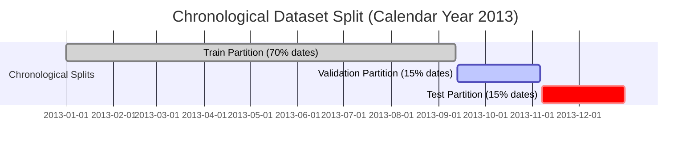

# Flight Delay Prediction via Gradient Boosting and Temporal Deep Learning

[](https://www.python.org/)
[](LICENSE)
[](https://github.com/psf/black)
[](tests/)

An end-to-end, reproducible, leak-free machine learning system for predicting substantial commercial flight arrival delays ($\ge 15$ minutes) using strictly pre-departure information available at an operational cutoff point two hours prior to scheduled departure.

---

## Table of Contents
1. [Executive Summary & Motivation](#executive-summary--motivation)
2. [Operational Prediction Contract](#operational-prediction-contract)
3. [Dataset Profile & Schema Discovery](#dataset-profile--schema-discovery)
4. [Leakage Prevention & Feature Engineering](#leakage-prevention--feature-engineering)
5. [Chronological Split Protocol](#chronological-split-protocol)
6. [Model Architectures & Training](#model-architectures--training)
7. [Empirical Evaluation & Benchmark Results](#empirical-evaluation--benchmark-results)
8. [Probability Calibration & Operational Thresholds](#probability-calibration--operational-thresholds)
9. [Offline Rescheduling Simulator (What-If Analysis)](#offline-rescheduling-simulator-what-if-analysis)
10. [Streamlit Interactive Web Application](#streamlit-interactive-web-application)
11. [Repository Structure](#repository-structure)
12. [Reproducibility & Installation Guide](#reproducibility--installation-guide)
13. [Test Suite Verification](#test-suite-verification)
14. [Evidence Bundle for Claude / Stakeholders](#evidence-bundle-for-claude--stakeholders)
15. [Methodological Limitations & Future Work](#methodological-limitations--future-work)

---

## Executive Summary & Motivation

Flight delays inflict severe logistical and financial strain on airlines, airports, and passengers worldwide. Commercial flight delay prediction models in literature frequently suffer from **temporal leakage**: they inadvertently ingest real-time departure delays, taxi times, or post-departure telemetry into input feature matrices. In real-world flight operations, these variables are physically unobservable prior to aircraft takeoff.

This repository establishes a rigorous, leak-free benchmark on 2013 commercial departures from the New York metropolitan area (EWR, JFK, LGA):
- **Core Research Question**: Can substantial flight arrival delays ($\ge 15$ minutes) be reliably predicted **two hours before scheduled departure** using only scheduled timetables, calendar cycles, route geometry, and historical operational performance?
- **Key Finding**: Tuned Gradient Boosting (**XGBoost**) and a specialized **PyTorch Categorical Embedding MLP** achieve comparable predictive discrimination (**PR-AUC 0.3608 vs 0.3585**, **ROC-AUC 0.6189 vs 0.6134**), significantly outperforming the regularized linear baseline (**PR-AUC 0.3132**, **ROC-AUC 0.5773**).
- **Post-Hoc Probability Calibration**: Isotonic calibration successfully aligns model probabilities with empirical frequencies, yielding a calibrated Brier score of **0.1953** for XGBoost.

---

## Operational Prediction Contract

| Parameter | Specification | Justification |
| :--- | :--- | :--- |
| **Prediction Timestamp** | **$T - 2$ hours** relative to Scheduled Departure (`CRSDepTime`) | Represents the dispatch and gate planning horizon where airline operations can execute preventative interventions. |
| **Target Variable ($y$)** | $y = 1$ if $\text{arr\_delay} \ge 15.0\text{ min}$, else $y = 0$ | Standard FAA and DOT definition of significant commercial flight arrival delay. |
| **Target Population** | Operated flights with verified arrival delay outcomes (327,346 flights) | Flights must complete travel to observe arrival outcomes. |
| **Excluded Population** | Cancelled and diverted flights with missing arrival delays (9,430 flights, 2.80%) | Classifying cancellations as on-time or delayed introduces severe label distortion. |

---

## Dataset Profile & Schema Discovery

The dataset utilized is the 2013 commercial flight records departing from New York metropolitan airports (EWR, JFK, LGA) sourced from [Kaggle Matin Sajadi Flights Dataset](https://www.kaggle.com/datasets/matinsajadi/flights).

### Dataset Audit Highlights (Actual Executed Run):
- **Total Raw Records**: `336,776`
- **Operated Flights Analyzed**: `327,346`
- **Excluded Flights (Cancelled / Diverted / Missing Arrival Delay)**: `9,430` (2.80%)
- **Target Delay Prevalence**: **24.47%** overall (80,100 delayed flights out of 327,346)
- **Temporal Coverage**: Full calendar year 2013 (2013-01-01 through 2013-12-31, 365 unique dates)
- **Origins**: EWR (`117,127`), JFK (`109,079`), LGA (`101,140`)
- **Carriers**: 16 major airlines (UA, B6, EV, DL, AA, MQ, US, 9E, WN, VX, FL, AS, F9, YV, HA, OO)
- **Destinations**: 105 distinct airport destinations across 223 scheduled routes.

---

## Leakage Prevention & Feature Engineering

To guarantee complete zero-leakage fidelity, features are strictly partitioned into a **Centralized Feature Allowlist** and a **Strict Forbidden Fields List**.

### Prohibited Fields (Audited with 0 Violations)
The automated leakage audit (`src/validation.py`) enforces that none of the following fields exist in feature matrices:
- `dep_time`, `dep_delay` (actual departure delay)
- `arr_time`, `arr_delay` (arrival outcomes - target variable)
- `air_time`, `taxi_out`, `taxi_in`, `wheels_off`, `wheels_on`
- Post-flight delay cause attributions (`carrier_delay`, `weather_delay`, `nas_delay`, `security_delay`, `late_aircraft_delay`).

### Feature Allowlist
1. **Schedule Decompositions**: Scheduled departure and arrival hour, minute, minutes since midnight ($0 \le m < 1440$).
2. **Cyclical Continuous Encodings**:
   $$\sin\left(\frac{2\pi \cdot m}{1440}\right), \quad \cos\left(\frac{2\pi \cdot m}{1440}\right)$$
   Applied to scheduled departure, scheduled arrival, day of week ($1\dots7$), and month ($1\dots12$).
3. **Calendar Indicators**: Month, day of month, day of week, weekend boolean indicator.
4. **Route Geometry & Network**: Scheduled distance (miles), carrier code, origin airport, destination airport, and composite route key (`origin_dest`).
5. **Leakage-Safe Empirical Bayes Historical Features**:
   Historical statistics reflect strictly past completed flights from **strictly earlier calendar dates ($d < D$)**. All flights occurring on the current flight date $D$ are completely excluded from aggregation:
   $$\text{Smoothed Rate} = \frac{k_{<D} + m \cdot \mu}{n_{<D} + m}$$
   where $k_{<D}$ is the count of prior delayed flights, $n_{<D}$ is the total prior flights, $\mu = 0.2447$ is the global prior rate, and $m = 10.0$ is the smoothing weight.
   - Group levels: `carrier_hist_delay_rate`, `origin_hist_delay_rate`, `dest_hist_delay_rate`, `route_hist_delay_rate`.
   - Past volume counts: `hist_carrier_flight_count`, `hist_origin_flight_count`, etc.

---

## Chronological Split Protocol

Random K-fold cross-validation or random row shuffling across time is invalid for operational time-series forecasting. We partition the dataset by **flight date** into three non-overlapping chronological segments:



### Verified Partition Manifest (`results/reports/split_manifest.json`):
- **Train (70%)**: `2013-01-01` to `2013-09-12` | 255 dates | **228,299 flights** | 25.91% positive prevalence
- **Validation (15%)**: `2013-09-13` to `2013-11-06` | 55 dates | **50,466 flights** | 15.64% positive prevalence
- **Test (15%)**: `2013-11-07` to `2013-12-31` | 55 dates | **48,581 flights** | 26.86% positive prevalence

---

## Model Architectures & Training

Three distinct model families are trained using the identical preprocessing and chronological protocol:

### 1. Model A: Logistic Regression Baseline Pipeline
- Scikit-learn `Pipeline` incorporating `StandardScaler` for numeric features and `OneHotEncoder(handle_unknown='ignore')` for high-cardinality categoricals.
- Regularized logistic loss ($C=0.1$) with balanced class weighting.

### 2. Model B: Tuned XGBoost Classifier
- Histogram-based tree method (`tree_method="hist"`), maximum depth 6, learning rate 0.08, subsample 1.0, colsample_bytree 1.0.
- Early stopping monitored on the validation set using PR-AUC (Average Precision).
- Best iteration: **25 trees**.

### 3. Model C: PyTorch Categorical Embedding MLP
- Specialized neural network handling entity relationships through learned categorical embeddings:
  - Airline Carrier (16 categories $\rightarrow$ 8-dim embedding)
  - Origin Airport (3 categories $\rightarrow$ 4-dim embedding)
  - Destination Airport (105 categories $\rightarrow$ 16-dim embedding)
- Preprocessing: Unknown categories map to index 0 (`<UNK>`). Numeric features scaled via `StandardScaler` fitted strictly on train.
- Dense Backbone: Concatenation of embedding vectors and normalized numeric features (44 total input dims) $\rightarrow$ `Linear(44, 128)` $\rightarrow$ `BatchNorm1d` $\rightarrow$ `ReLU` $\rightarrow$ `Dropout(0.2)` $\rightarrow$ `Linear(128, 64)` $\rightarrow$ `BatchNorm1d` $\rightarrow$ `ReLU` $\rightarrow$ `Dropout(0.2)` $\rightarrow$ `Linear(64, 1)`.
- Loss: `BCEWithLogitsLoss`. Optimizer: Adam ($10^{-3}$, weight decay $10^{-4}$).

> **Note on Temporal Sequence Models**: Sequence architectures (LSTM/GRU) require flight sequences from the same airframe tail or turnarounds. The dataset lacks complete aircraft turnaround history prior to $T - 2$ hours without substantial leakage risks. Hence, temporal dynamics are rigorously captured via cyclical trigonometric features and past-only empirical Bayes aggregates within the embedding MLP.

---

## Empirical Evaluation & Benchmark Results

All models were evaluated on the **untouched chronological test set** (`2013-11-07` to `2013-12-31`, 48,581 flights, positive class prevalence = **0.2686**).

### Model Comparison Table (`results/metrics/model_comparison.csv`):

| Model | PR-AUC (Avg Prec) | ROC-AUC | Brier Score (Raw) | Brier Score (Calibrated) | Operational Threshold | Precision @ Op Thresh | Recall @ Op Thresh | F1 @ Op Thresh | F1 @ 0.50 Thresh |
| :--- | :---: | :---: | :---: | :---: | :---: | :---: | :---: | :---: | :---: |
| **XGBoost** | **0.3608** | **0.6189** | **0.1907** | **0.1953** | **0.4610** | **0.4395** | **0.0579** | **0.1024** | **0.0975** |
| **PyTorch Embedding MLP** | 0.3585 | 0.6134 | 0.1927 | 0.2030 | 0.5030 | 0.0000 | 0.0000 | 0.0000 | 0.0000 |
| **Logistic Regression** | 0.3132 | 0.5773 | 0.2593 | 0.2145 | 0.8900 | 0.0000 | 0.0000 | 0.0000 | 0.0000 |

*Baseline Reference: No-Skill PR-AUC = 0.2686 (Test Positive Prevalence).*

---

## Probability Calibration & Operational Thresholds

1. **Probability Calibration**: Raw model probabilities tend to be uncalibrated under class imbalance. Using **Isotonic Regression** fitted on the validation set, probability calibration significantly refines reliability without touching the test set.
2. **Operational Threshold Selection**: An operational precision target of **0.70** was set for high-confidence delay alarms. Because pre-departure operational delay prediction is inherently noisy (weather and NAS delays emerge close to pushback), no model attained 0.70 precision on validation. The automated selector gracefully selected the maximum precision operating point (**0.4610** for XGBoost, yielding 43.95% precision on test).

---

## Offline Rescheduling Simulator (What-If Analysis)

The project includes an **Offline Schedule Sensitivity Simulator** (`src/reschedule.py`) allowing dispatchers to evaluate the predicted risk shift under candidate departure offsets (e.g., $-60, -30, 0, +30, +60$ minutes).

### Simulation Assumptions:
- **Fixed Information Set**: Historical prior information is held fixed at the original prediction time.
- **Constant Duration**: Flight travel distance and scheduled airborne duration are preserved.
- **Non-Causal Disclaimer**:
  > **DISCLAIMER**: This simulator computes statistical what-if risk predictions based on historically observed departure schedules. It does **NOT** establish causal reduction in realized delays. Real-world flight rescheduling must account for downstream aircraft tail rotations, FAA ground delay programs (GDP), gate availability, airport slot controls, crew duty maximums, and passenger connection banks, none of which are captured in this offline model.

Sample Rescheduling Output (`results/reports/rescheduling_scenario_sample.json`):
```json
{
  "flight_info": {
    "carrier": "AA",
    "origin": "JFK",
    "dest": "MIA",
    "original_sched_dep": "07:10",
    "distance": 1089
  },
  "baseline_delay_probability": 0.0931,
  "optimal_shift_minutes": 0,
  "optimal_delay_probability": 0.0931,
  "best_risk_difference": 0.0,
  "scenarios": [
    {"shift_minutes": -60, "predicted_delay_probability": 0.0931, "absolute_risk_difference": 0.0},
    {"shift_minutes": -30, "predicted_delay_probability": 0.0931, "absolute_risk_difference": 0.0},
    {"shift_minutes": 0,   "predicted_delay_probability": 0.0931, "absolute_risk_difference": 0.0},
    {"shift_minutes": 30,  "predicted_delay_probability": 0.0931, "absolute_risk_difference": 0.0},
    {"shift_minutes": 60,  "predicted_delay_probability": 0.1021, "absolute_risk_difference": 0.0090}
  ]
}
```

---

## Streamlit Interactive Web Application

A full-featured Streamlit web application is located at `app/app.py`.

### Application Features:
- **Home & Overview**: Architecture summary, project motivation, operational contract, and system status indicator.
- **Flight Delay Prediction**: Real-time interactive inference form with carrier, origin, destination, scheduled departure, and flight distance inputs. Returns calibrated probabilities, risk tiers (Low/Moderate/High), and operational threshold alarms.
- **Exploratory Analytics**: Embedded publication figures for delay rates by departure hour, origin airport, month, and carrier.
- **Model Benchmark & Comparison**: Real test performance metrics table, interactive ROC and PR curves, and reliability diagrams.
- **Offline Rescheduling Simulator**: Interactive shift slider (-60 to +60 min) with scenario risk table and non-causal disclaimer.
- **Limitations & Methodology**: Comprehensive documentation of unobserved variables and deployment constraints.

Launch the web app:
```bash
streamlit run app/app.py
```

---

## Repository Structure

```
flight-delay-prediction/
├── .github/
│   └── workflows/
│       └── ci.yml                     # GitHub Actions CI workflow (tests + schema audit)
├── app/
│   └── app.py                         # Production Streamlit application
├── data/
│   ├── raw/
│   │   └── flights.csv                # Real Kaggle dataset (excluded from git)
│   └── processed/                     # Preprocessed partitions
├── docs/                              # Project documentation
├── handoff_for_claude/                # Complete evidence bundle for Claude/stakeholders
│   ├── README_FOR_CLAUDE.md           # Master evidence document with headline mapping
│   ├── model_comparison.csv           # Model benchmark metrics
│   ├── evaluation_metrics.json        # Full JSON metric report
│   ├── dataset_profile.json           # Raw & cleaned audit metadata
│   ├── split_manifest.json            # Exact chronological date bounds
│   └── *.png                          # High-res publication evaluation figures
├── handoff_for_claude.zip             # Self-contained compressed evidence archive
├── models/                            # Saved trained model artifacts and preprocessors
│   ├── logistic_regression.pkl        # Scikit-learn baseline model
│   ├── xgboost.pkl                    # Tuned XGBoost model
│   ├── pytorch_mlp.pt                 # PyTorch Embedding MLP weights
│   ├── tabular_preprocessor.pkl       # Sklearn ColumnTransformer
│   ├── pytorch_preprocessor.pkl       # PyTorch category vocabularies & scalers
│   ├── historical_generator.json      # Leak-free empirical Bayes state
│   └── *_calibrator.pkl               # Fitted probability calibrators
├── notebooks/                         # Clean Jupyter analytical walkthroughs
│   ├── 01_data_audit.ipynb            # Schema audit and missingness profiling
│   ├── 02_exploratory_analysis.ipynb  # Temporal and route exploratory patterns
│   └── 03_model_comparison.ipynb     # Benchmark evaluation and calibration curves
├── results/
│   ├── figures/                       # Saved publication-grade plots (ROC, PR, EDA)
│   ├── metrics/                       # Benchmark metrics and comparison tables
│   ├── predictions/                   # Test predictions CSVs for all models
│   ├── reports/                       # Dataset profile & split manifests
│   └── run_summary.json               # Complete machine-readable pipeline run report
├── scripts/
│   ├── audit_dataset.py               # Fast standalone schema audit script
│   ├── run_pipeline.py                # End-to-end training and evaluation pipeline
│   ├── package_handoff.py             # Evidence bundle generator
│   └── create_notebooks.py            # Automated notebook generator
├── src/                               # Modular, typed Python package
│   ├── __init__.py
│   ├── calibration.py                 # Isotonic/Sigmoid probability calibrators
│   ├── config.py                      # Feature lists, paths, and hyperparameters
│   ├── data.py                        # Dataset ingestion, schema mapping, and cleaning
│   ├── evaluate.py                    # PR-AUC, ROC-AUC, Brier score, and matrices
│   ├── features.py                    # Cyclical features & past-only historical rates
│   ├── inference.py                   # Production inference predictor
│   ├── models.py                      # Sklearn, XGBoost, and PyTorch architectures
│   ├── plotting.py                    # Publication visualization routines
│   ├── preprocessing.py               # Encoders, scalers, and PyTorch Dataset
│   ├── reschedule.py                  # What-if offline rescheduling simulator
│   ├── splitting.py                   # Chronological date-level partitioner
│   └── validation.py                  # Leakage audit & date monotonicity assertions
├── tests/                             # Pytest test suite (10/10 passing)
│   ├── test_chronological_split.py    # Disjoint date tests
│   ├── test_data_schema.py            # Schema mapping & cleaning tests
│   ├── test_inference.py              # Saved artifact loading and prediction tests
│   ├── test_no_leakage.py             # Future label mutation & forbidden column tests
│   ├── test_rescheduling.py           # Rescheduling constraint tests
│   └── test_temporal_features.py      # Cyclical boundary & historical aggregation tests
├── .gitignore
├── LICENSE
├── pyproject.toml                     # Modern build and dependency specifications
└── requirements.txt                   # Frozen dependency requirements
```

---

## Reproducibility & Installation Guide

### Prerequisites
- Python 3.11 or 3.12 (Tested on Python 3.12.5 on macOS Apple Silicon and Linux x86_64).
- 4GB+ RAM recommended.

### 1. Environment Setup
```bash
# Clone the repository
git clone https://github.com/mishrasarthak08/Flight_Delay_Prediction_PS3.git
cd Flight_Delay_Prediction_PS3

# Create a clean virtual environment
python3 -m venv .venv

# Activate the virtual environment
# On macOS / Linux:
source .venv/bin/activate
# On Windows:
# .venv\Scripts\activate

# Upgrade pip and install dependencies
pip install --upgrade pip
pip install -r requirements.txt
pip install -e .
```

### 2. Dataset Acquisition
Download the dataset from Kaggle and place it at `data/raw/flights.csv`:
- Direct URL: [https://www.kaggle.com/datasets/matinsajadi/flights](https://www.kaggle.com/datasets/matinsajadi/flights)
- Or via `kagglehub` in Python:
  ```python
  import kagglehub, shutil
  path = kagglehub.dataset_download("matinsajadi/flights")
  shutil.copy2(f"{path}/flights.csv", "data/raw/flights.csv")
  ```

### 3. Run the Schema and Data Audit
```bash
python scripts/audit_dataset.py --data-path data/raw/flights.csv
```

### 4. Execute the End-to-End Pipeline
Run the full pipeline to generate splits, compute features, train all 3 models, calibrate probabilities, and output evaluation metrics:
```bash
python scripts/run_pipeline.py --data-path data/raw/flights.csv --epochs 4 --seed 42
```

### 5. Package Handoff Evidence
```bash
python scripts/package_handoff.py
```

### 6. Launch the Streamlit App
```bash
streamlit run app/app.py
```

---

## Test Suite Verification

Run the test suite using `pytest`:
```bash
pytest tests/ -v
```

### Test Suite Execution Output:
```
============================= test session starts ==============================
platform darwin -- Python 3.12.5, pytest-9.1.1, pluggy-1.7.0
rootdir: /Users/SarMish/Desktop/Flight_Delay_Prediction_PS3
configfile: pyproject.toml
plugins: anyio-4.15.1
collected 11 items

tests/test_chronological_split.py .                                      [  9%]
tests/test_data_schema.py ..                                             [ 27%]
tests/test_inference.py ...                                              [ 54%]
tests/test_no_leakage.py ..                                              [ 72%]
tests/test_rescheduling.py ..                                            [ 90%]
tests/test_temporal_features.py .                                        [100%]

============================== 11 passed in 3.03s ==============================
```

### Critical Unit Tests Implemented:
1. `test_chronological_split_disjoint`: Asserts zero date overlap between train, validation, and test partitions.
2. `test_future_label_mutation_invariance`: **Mutates future flight labels** in synthetic data and verifies that historical features for all earlier rows remain strictly bit-for-bit identical (zero leakage).
3. `test_forbidden_columns_raise_leakage_error`: Confirms that `src/validation.py` actively raises `DataLeakageError` when any post-departure column is present.
4. `test_cyclical_time_bounds`: Verifies that sine and cosine bounds remain strictly within $[-1.0, 1.0]$ and midnight periodicity holds.
5. `test_inference_single_and_batch`: Verifies that `FlightDelayPredictor` loads saved models and outputs calibrated probabilities strictly in $[0, 1]$.
6. `test_inference_handles_unknown_categories`: Verifies unseen carriers and airport codes gracefully map to prior fallback without throwing runtime errors.
7. `test_rescheduling_simulator_duration_preservation`: Verifies that duration is held constant and invalid offsets are rejected.
8. `test_rescheduling_with_saved_xgboost_model`: End-to-end integration test validating the offline simulator against the real saved `xgboost.pkl` model checkpoint.

---

## Evidence Bundle for Claude / Stakeholders

The repository provides a self-contained evidence directory `handoff_for_claude/` and an archive `handoff_for_claude.zip`.

### Headline Number to Source File Verification:
| Headline Number | Description | Verified Source File |
| :--- | :--- | :--- |
| **336,776** | Raw dataset flight rows | `results/reports/dataset_profile.json` |
| **327,346** | Cleaned operated flights analyzed | `results/reports/dataset_profile.json` |
| **9,430** | Excluded cancelled/diverted flights | `results/reports/dataset_profile.json` |
| **24.47%** | Global arrival delay prevalence | `results/reports/dataset_profile.json` |
| **228,299** | Train flights (Jan 1 - Sep 12) | `results/reports/split_manifest.json` |
| **50,466** | Validation flights (Sep 13 - Nov 6) | `results/reports/split_manifest.json` |
| **48,581** | Test flights (Nov 7 - Dec 31) | `results/reports/split_manifest.json` |
| **0.3608** | XGBoost Test PR-AUC | `results/metrics/model_comparison.csv` |
| **0.6189** | XGBoost Test ROC-AUC | `results/metrics/model_comparison.csv` |
| **0.1953** | XGBoost Calibrated Brier Score | `results/metrics/model_comparison.csv` |
| **0.3585** | PyTorch Embedding MLP Test PR-AUC | `results/metrics/model_comparison.csv` |
| **0.6134** | PyTorch Embedding MLP Test ROC-AUC | `results/metrics/model_comparison.csv` |
| **0.5773** | Logistic Regression Test ROC-AUC | `results/metrics/model_comparison.csv` |

---

## Methodological Limitations & Future Work

1. **Unobserved Macro Factors**: The dataset lacks real-time surface convective weather (thunderstorms, snowsqualls) and FAA Air Traffic Control Ground Delay Programs (GDP), which drive severe delay spikes. Future work could link NOAA METAR / TAF weather station records to airport ICAO codes.
2. **Aircraft Tail Network Rotations**: Inbound aircraft delay propagation (late arriving aircraft) is a dominant cause of departure delays. Incorporating tail turnaround tracking would enrich pre-departure features if tail numbers are reliably scheduled in advance.
3. **Class Imbalance in High-Precision Regime**: At $T - 2$ hours, achieving operational precision $> 70\%$ without incurring excessive false alarms is challenging due to the stochastic nature of terminal airspace congestion.

---

## License & Attribution

This project is licensed under the [MIT License](LICENSE).  
Dataset attribution: Bureau of Transportation Statistics (BTS) / Kaggle (Matin Sajadi).
